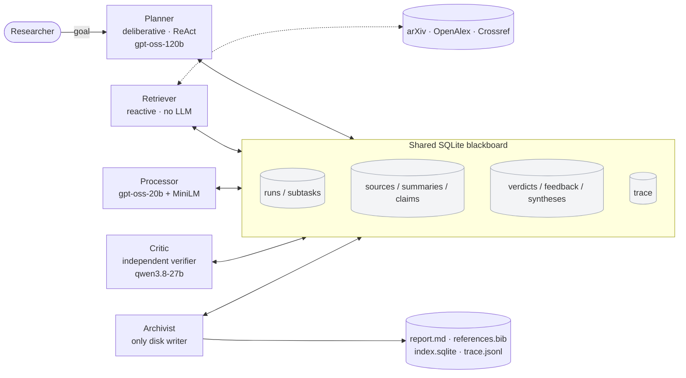
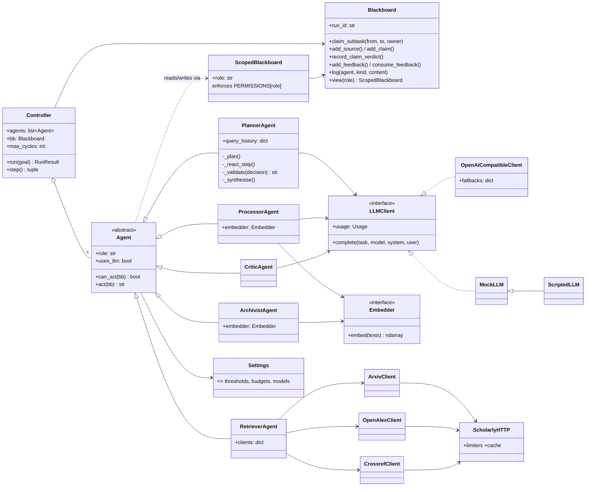
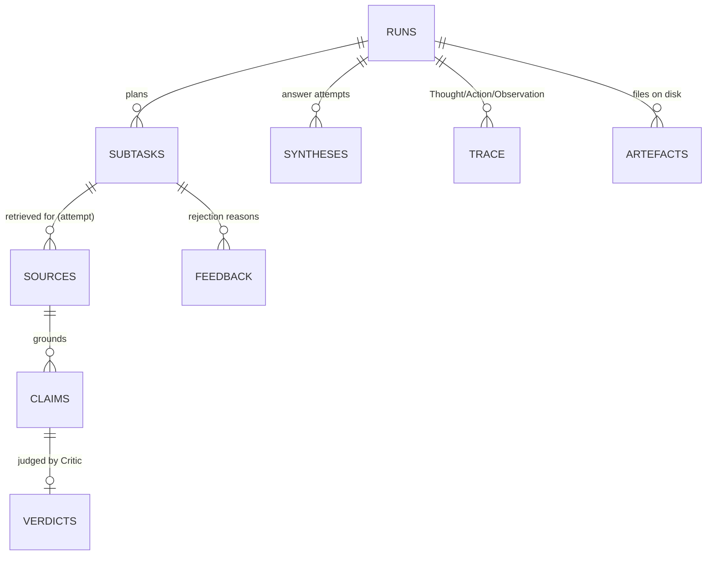

# ScholarPlan: an LLM-powered planning agent for academic research

ScholarPlan is a **multi-agent system** that takes a research goal in plain English, plans a literature search, retrieves papers from **arXiv, OpenAlex and Crossref**, turns their abstracts into atomic claims, **independently verifies every claim against its source**, and stores a cited report, a BibTeX file, a searchable vector index and a full reasoning trace offline.

It implements the design proposed in the Unit 6 group report *"ScholarPlan: An LLM-Powered Planning Agent for Academic Research and Information Gathering"* (Intelligent Agents module, September 2026). This README documents what was built, how to run it, how it was tested, where it departs from that design and why, and the sources it relies on.

| | |
|---|---|
| **Agents** | Planner (deliberative, ReAct), Retriever, Processor, Critic, Archivist (reactive) |
| **Coordination** | Shared SQLite **blackboard**; agents never call each other |
| **Models** (Groq free tier) | Planner `gpt-oss-120b` · Processor `gpt-oss-20b` · Critic `qwen3.8-27b` |
| **Tests** | 94 automated tests (82 unit incl. regression tests + 12 functional), **93% line coverage**, plus 4 live smoke tests |
| **Evaluation** | Critic precision **1.00** / recall **1.00** (targets 0.85 / 0.75) · retrieval recall **0.90** (target 0.75) · 3/3 live goals completed within budget |

---

## Contents
1. [Quick start](#1-quick-start)
2. [What the system does](#2-what-the-system-does)
3. [Architecture and design](#3-architecture-and-design)
4. [From design to implementation](#4-from-design-to-implementation)
5. [Deviations from the Unit 6 design](#5-deviations-from-the-unit-6-design)
6. [Responding to the Unit 6 feedback](#6-responding-to-the-unit-6-feedback)
7. [Testing and remediation](#7-testing-and-remediation)
8. [Evaluation against measurable targets](#8-evaluation-against-measurable-targets)
9. [Evidence of execution](#9-evidence-of-execution)
10. [Legal, social, ethical and professional considerations](#10-legal-social-ethical-and-professional-considerations)
11. [Limitations and future work](#11-limitations-and-future-work)
12. [Project structure and development history](#12-project-structure-and-development-history)
13. [Acknowledgements and references](#13-acknowledgements-and-references)

---

## 1. Quick start

**Requirements:** Windows, macOS or Linux; internet access; [uv](https://docs.astral.sh/uv/) (it installs Python 3.11 automatically). No GPU is needed.

```bash
# 1. Install uv (once), then the project's dependencies into .venv
pip install uv
uv sync

# 2. Configure the LLM key (optional: without it the system runs in offline "mock" mode)
cp .env.example .env        # then paste your free Groq key after GROQ_API_KEY=
                            # (create one at https://console.groq.com -> API Keys; no card required)
```

> Run every command from inside the `scholarplan` folder. If your shell says `uv` is not recognised, `pip` installed it into a folder that is not on your PATH (common with per-user Python on Windows). Use `python -m uv` instead, or `py -m uv` on Windows: for example `py -m uv run scholarplan ui`.
>
> **Without uv:** every dependency is also pinned in `requirements.txt` (exported from `uv.lock`). With Python 3.11 or 3.12, run `python -m venv .venv`, activate it, then `pip install -r requirements.txt`. The commands below then work without the `uv run` prefix (for example `scholarplan ui`, `pytest`).

| Task | Command |
|---|---|
| Run the agents from the terminal (live models) | `uv run scholarplan run "How does verifying LLM outputs against retrieved sources reduce hallucination?"` |
| Run fully offline, no key needed | `uv run scholarplan run "react agents evaluation" --llm mock` |
| Demo: plant one false claim and watch the Critic reject it | `uv run scholarplan run "How do LLM critics detect hallucinated claims?" --inject-fabrication` |
| Open a specific run/view in the dashboard | `http://localhost:8501/?run=<run_id>&tab=claims` (tabs: trace, subtasks, sources, claims, feedback, report, metrics) |
| Open the live dashboard (http://localhost:8501) | `uv run scholarplan ui` |
| Search a finished run's vector index | `uv run scholarplan search output/<run_id> "critic verification"` |
| Run the test suite with coverage | `uv run pytest --cov=scholarplan` |
| Also run live smoke tests (needs key) | `uv run pytest --live` |
| Re-run the evaluation harness | `uv run python eval/run_eval.py all` |

Each run writes to `output/<run_id>/`: `report.md`, `references.bib`, `index.sqlite`, `trace.jsonl` and `run_summary.json`. A typical live run takes about one minute and roughly 21,000 tokens, well inside Groq's free daily allowance.

---

## 2. What the system does

1. **Plan.** The Planner decomposes the goal into at most four keyword-style subtasks, as schema-validated JSON.
2. **Act and observe (ReAct loop).** Each step the Planner reads the blackboard (the *Observation*), writes a *Thought*, and takes one *Action*: issue, refine or abandon a subtask, switch database, or synthesise.
3. **Retrieve.** The Retriever queries arXiv, OpenAlex and Crossref, recording provenance (identifier, URL, fetch time).
4. **Process.** The Processor removes duplicates (DOI, title, embedding similarity ≥ 0.92), discards irrelevant records (cosine < 0.30), keeps the top 3, and asks an LLM for a summary plus at most 2 **atomic claims** per source.
5. **Verify.** The Critic, a *different model family*, labels each claim *supported* or *unsupported* by its abstract. If fewer than 50% are supported, it writes **Feedback** and rejects the subtask.
6. **Re-plan.** The Planner reads the feedback before its next Thought and narrows or broadens the query, switches database, or abandons the subtask (**at most 3 re-plans**, then "unresolvable").
7. **Synthesise and check.** The Planner writes an answer citing only verified claims (`[C12]`); the Critic checks it again. After two rejections an extractive fallback is used, which cannot contain unsupported text.
8. **Archive.** The Archivist writes the report with Harvard citations, the BibTeX file, a `sqlite-vec` index and the full trace.

Termination is guaranteed without trusting the LLM: there is a 20-step ReAct budget, a 3-re-plan cap per subtask, a synthesis-attempt cap, and a controller cycle limit.

---

## 3. Architecture and design

### 3.1 Architectural view (agents and blackboard)



### 3.2 Structural view: UML class diagram (new in Unit 11, addressing feedback #1)



The blackboard's data structures (one table per artefact named in the Unit 6 sequence diagram):



### 3.3 Subtask life-cycle (the reactive triggers)

`pending → open (Planner) → retrieving → retrieved (Retriever) → processing → processed (Processor) → verifying → verified | rejected (Critic) → [Planner reads feedback] → open again (≤ 3 times) | abandoned | unresolvable`

Each agent's `can_act()` simply checks for its trigger state; the `Controller` runs the first applicable agent in "downstream-first" order (Critic → Processor → Retriever → Archivist → Planner). This is the blackboard *control component* (Hayes-Roth, 1985). It holds no domain logic, so agents can be added without changing it.

### 3.4 Gaia roles and permissions

| Role | Responsibility | Trigger | May write |
|---|---|---|---|
| Planner | decompose, ReAct decisions, synthesis | `planning`, unread feedback, idle | runs, subtasks, feedback (consume), syntheses, trace |
| Retriever | query 3 APIs with provenance | subtask `open` | subtasks, sources, feedback, trace |
| Processor | dedup → rank → summarise → claims | subtask `retrieved` | subtasks, sources (annotate), summaries, claims, feedback, trace |
| Critic | entailment check of claims and synthesis | subtask `processed`, synthesis `pending` | subtasks, claims, verdicts, feedback, syntheses, trace |
| Archivist | write all outputs to disk | synthesis `verified`/`fallback` | runs, artefacts, trace |

These permissions are **enforced at runtime** by `ScopedBlackboard` (a Retriever trying to write a verdict raises `PermissionError`; see `tests/unit/test_blackboard.py`), following the Gaia methodology (Wooldridge, Jennings and Kinny, 2000).

---

## 4. From design to implementation

| Unit 6 design element | Where it is implemented | Evidence |
|---|---|---|
| Hybrid architecture: one deliberative LLM planner + reactive specialists | `agents/planner.py`; `agents/{retriever,processor,critic,archivist}.py` | trace shows only the Planner deliberating |
| Blackboard coordination in SQLite; agents never invoke each other | `blackboard.py`, `controller.py` | no agent imports another; `test_claim_is_atomic_under_concurrency` |
| ReAct (Thought → Action → Observation) | `PlannerAgent._react_step` | `trace.jsonl`; `test_refine_records_new_query_and_attempt` |
| Reflexion-style re-planning from written Feedback | `add_feedback` in Retriever/Processor/Critic; Planner reads it | `test_critic_rejection_triggers_reflexion_replanning`; live run with 2 re-plans |
| Independent Critic, different model (LLM-Modulo) | `agents/critic.py` | Critic benchmark (section 8) |
| Schema-valid JSON from LLMs | `llm/schemas.py` + `call_json` repair loop | `test_call_json_repairs_invalid_output` |
| 20-step budget; coverage threshold | `config.py`, `PlannerAgent.act`, `allowed_actions` | `test_step_budget_bounds_the_run` |
| Keyless APIs with stable identifiers and provenance | `sources/clients.py` | recorded-fixture parser tests |
| Local sentence embeddings for dedup and ranking | `embeddings.py` (all-MiniLM-L6-v2), `processor.select_sources` | dedup/relevance unit tests |
| SQLite transactions for atomic claims | `Blackboard.claim_subtask` (`BEGIN IMMEDIATE`) | concurrency test, 8 threads, 1 winner |
| Source caching and arXiv's 3-second rule | `sources/http.py` | `test_http_cache_avoids_second_network_call`, `test_rate_limiter_enforces_spacing` |
| Offline outputs: report, BibTeX, vector index, trace | `agents/archivist.py` (`sqlite-vec`) | `test_vector_index_round_trip`; `evidence/runs/` |
| Plain Python, no LangChain/LangGraph | whole codebase (dependencies: httpx, pydantic, numpy, sentence-transformers, sqlite-vec, streamlit) | `pyproject.toml` |
| Testing by agent type + evaluation harness | `tests/unit`, `tests/functional`, `eval/` | sections 7–8 |
| Python 3.11, uv, Git/GitHub, pytest | `.python-version`, `uv.lock` | this repository |

---

## 5. Deviations from the Unit 6 design

Each change keeps the *reason* behind the original decision while adapting to constraints that only became visible during implementation. This reflects the empirical, sprint-based approach the design itself argued for (Sommerville, 2016).

| Design said | Implemented | Why |
|---|---|---|
| GPT-5-mini (Planner/Processor) on **Azure for Students** | `gpt-oss-120b` (Planner) and `gpt-oss-20b` (Processor) on **Groq's free tier** | No Azure subscription was available at build time. gpt-oss is OpenAI's open-weight family, so the provider changes but the vendor family does not. Groq needs no card, and its OpenAI-compatible API means switching back to Azure is a base-URL change. Splitting 120b/20b doubles usable throughput, because Groq meters tokens per model. This mirrors the design's GPT-5-mini/nano split. |
| Llama-3.3-70B as Critic | `qwen/qwen3.8-27b`, with automatic fallback to `gpt-oss-120b` | Groq returned `404 model_not_found` for Llama-3.3-70B on this free account (remediation **R8**). The property the design relied on was *independence*: the verifier is a different model family from the generator (Kambhampati et al., 2024). Qwen preserves that. It was then validated empirically and matched the fallback on our benchmark (section 8). |
| bespoke-minicheck:7b via Ollama for Critic testing | Deterministic `MockLLM` / `ScriptedLLM` for tests, plus a labelled Critic benchmark run against the real models | The development laptop has integrated graphics only (no discrete GPU), so a local 7B model would be slow. Scripted mocks *force* every failure path deterministically, which a real model cannot guarantee. |
| One Critic call per claim | One Critic call per subtask (all claims batched, each still judged individually) | It cuts calls about 4×, staying within free-tier rate limits without changing the per-claim verdicts. |
| Command-line operation | CLI **and** a Streamlit dashboard | Makes the blackboard observable live, for explainability and the demonstration. |

---

## 6. Responding to the Unit 6 feedback

| Tutor feedback | Response in Unit 11 |
|---|---|
| **1. "A static structural view, such as a UML Class Diagram, is missing."** | Added: section 3.2 (class diagram) and the blackboard data-structure diagram, both generated from the actual code. |
| **2. "Give clear, measurable targets, including the test queries, deduplication thresholds and … Critic precision and recall."** | All thresholds are named constants in `config.py` (dedup cosine **0.92**, relevance floor **0.30**, top-k **3**, Critic pass ratio **50%**). There are 10 fixed retrieval queries with known relevant papers (`eval/retrieval_benchmark.json`), and 21 hand-labelled claim–source pairs (`eval/critic_benchmark.json`). Targets were set *before* running: retrieval recall ≥ 0.75; Critic precision ≥ 0.85 and recall ≥ 0.75. Results are in section 8. |
| **3. "What happens when … a Critic keeps rejecting the same result? … limit each subtask to three re-planning attempts."** | `max_replans_per_subtask = 3` is enforced **in code, not by the LLM**: on the fourth failure the subtask becomes `unresolvable` without an LLM call. There are also a synthesis-attempt cap (2, then an extractive fallback) and the 20-step budget. Tested by `test_replan_cap_marks_unresolvable_without_llm` and `test_replan_cap_marks_subtask_unresolvable` (end-to-end). |

---

## 7. Testing and remediation

**Strategy** (following the Unit 6 plan of "testing by agent type"):

* **Unit tests (82, including regression tests for fixed defects)** cover the deterministic components: blackboard atomicity and permissions; API parsers run against **recorded real responses** (`tests/fixtures/`); rate limiting, caching and retries via injected `httpx` transports; dedup and relevance thresholds; Critic acceptance rules; Planner action validation, re-plan cap and budget; Harvard and BibTeX formatting; and the vector index.
* **Functional tests (12)** run the whole multi-agent system end to end, offline. Each forces one behaviour: the happy path; Critic rejection leading to re-planning; the re-plan cap; no-results feedback; budget exhaustion; an **injected hallucination** being filtered; synthesis rejection then fallback; isolation of a failed API; the CLI; a later semantic search of the saved index; and the labelled demo-fabrication switch.
* **Live smoke tests (4, `pytest --live`)** detect *drift* in external services (API format changes, withdrawn models).
* **Evaluation harness** (section 8) estimates the quality of the non-deterministic LLM components, which unit tests cannot establish.

```text
$ uv run pytest --cov=scholarplan
94 passed, 4 skipped (live) in ~3 s        TOTAL coverage: 93%
$ uv run pytest tests/live --live
4 passed in ~11 s
```

Full outputs are in [`evidence/tests/`](evidence/tests/) (console log, JUnit XML, coverage report).

**Remediation.** All 19 defects found during development are documented in [`docs/REMEDIATION_LOG.md`](docs/REMEDIATION_LOG.md), each with how it was found, its root cause, the fix and the verifying test. Highlights:
* **R8**: the planned Critic model was withdrawn by the provider. Fixed by a substitution mechanism plus a regression test.
* **R10**: OpenAlex `429` errors in the first live run. Fixed by honouring `Retry-After`, with request spacing raised to 1 s.
* **R15**: in a live run the Planner **misdiagnosed** a model-format failure as a bad query, because the feedback message lacked the cause. Feedback now carries the diagnosis. This is a lesson about Reflexion-style systems: self-correction is only as good as the feedback signal.
* **R9, R11, R13**: three cases where the *test*, not the system, was wrong. They are recorded because each clarified intended behaviour (for example, near-duplicate test data was correctly de-duplicated).

---

## 8. Evaluation against measurable targets

Run with `uv run python eval/run_eval.py all`; raw results are in [`evidence/evaluation/`](evidence/evaluation/).

**Critic quality** (21 hand-labelled pairs, 12 supported and 9 hallucinated; the hallucination types are over-generalisation, wrong entity, fabricated number, metric shift, contradiction and fabricated contribution):

| Critic | Precision | Recall | Hallucinations caught | Target met |
|---|---|---|---|---|
| Lexical-overlap baseline | 0.83 | 0.83 | 7 / 9 | ✗ |
| **qwen3.8-27b (production)** | **1.00** | **1.00** | **9 / 9** | ✓ |
| gpt-oss-120b (fallback) | 1.00 | 1.00 | 9 / 9 | ✓ |

The baseline misses contradictions and metric shifts that reuse the source's words. This is why an LLM entailment judge, rather than string matching, is justified. *Caveat:* 21 items is small, and a perfect score shows a ceiling effect, not proof of perfection (see section 11).

**Retrieval** (10 fixed queries; the targets are papers cited in the Unit 6 report):

| Metric | Result | Target |
|---|---|---|
| Recall (known paper retrieved) | **0.90** (9/10) | ≥ 0.75 ✓ |
| Found by arXiv / OpenAlex / Crossref | 7 / 6 / 1 | (no single API finds all, which justifies querying three) |
| Missed | Hayes-Roth (1985) | old work without an indexed abstract, excluded by our `has_abstract` filter (a deliberate verifiability trade-off) |

**End-to-end live runs** (3 fixed goals): **3/3 completed within the 20-step budget**; mean 6.7 steps; mean 58.5 s; about 21k tokens per run; 2 genuine re-plans (triggered by a Processor output failure); Critic pass rate over produced claims 1.00.

---

## 9. Evidence of execution

| Evidence | Location |
|---|---|
| Live terminal run (Thought/Action/Observation trace) | `evidence/runs/live_cli_run.log` |
| Generated report, BibTeX, trace and metrics from a live run | `evidence/runs/20261011-191009-2cb25b/` |
| Live run with **genuine re-planning** (2 re-plans after Processor failures) | `evidence/runs/replanning_run/`, screenshots 07–09 |
| Live run where the **Critic rejects a planted fabricated claim** | `evidence/runs/live_demo_fabrication.log`, `evidence/runs/demo_fabrication_run/`, screenshot 10 |
| Dashboard screenshots: trace, subtasks, sources (dedup/relevance), claims and verdicts, report, metrics | `evidence/screenshots/01–06` |
| Test-suite output, JUnit XML, coverage | `evidence/tests/` |
| Evaluation results (JSON) | `evidence/evaluation/` |
| Development history | `git log` (sprint-tagged commits) and `docs/REMEDIATION_LOG.md` |
| Presentation (10 slides, speaker notes) and narration transcript | `presentation/ScholarPlan_Unit11_Presentation.pptx`, `presentation/ScholarPlan_Narration_Transcript.docx` (source: `presentation/TRANSCRIPT.md`) |

---

## 10. Legal, social, ethical and professional considerations

* **Terms of use and polite access.** arXiv's limit of one request every 3 s is enforced centrally (`RateLimiter`); OpenAlex and Crossref are spaced at 1 request/s; every request identifies the client in its User-Agent, and an optional contact email can be added (`SCHOLARPLAN_CONTACT_EMAIL`) per Crossref's etiquette. Responses are cached, so repeated runs do not re-query the APIs.
* **Copyright.** Only bibliographic metadata and abstracts are processed and stored; full texts are never downloaded. Every claim is attributed with a Harvard citation and a DOI or arXiv link.
* **Hallucination and misinformation.** Claims reach the report only if an independent model judged them supported. Rejected claims are counted in the report. The report carries a notice that it is AI-generated and verified at abstract level only, so it is a starting point for reading, not a substitute for it.
* **Academic integrity.** ScholarPlan is a literature-*discovery* aid. Its output should not be submitted as one's own writing, and the report says how it was produced.
* **Bias.** Sources are mainly English, recency-biased (the `has_abstract` filter excludes much older work, see section 8) and ranked by API relevance, which can favour highly cited authors. These biases are stated rather than hidden.
* **Privacy and data protection.** The research goal is sent to Groq (a third party). Users should not enter personal or confidential data. No personal data is collected or stored. Traces log relative paths only (R18).
* **Security.** API keys live in `.env`, which is git-ignored (as are `*api_key*` files). Keys are never logged; the `Settings` dump in the trace excludes the key.
* **Professional practice.** Version control with descriptive commits, automated tests, a remediation log, documented deviations, and reproducible environments (`uv.lock`).
* **Sustainability and cost.** About 21k tokens per run on shared free infrastructure; the step budget and caching cap resource use.

---

## 11. Limitations and future work

* **Abstract-level verification only.** A claim can be "supported by the abstract" yet qualified in the full paper. Next step: open-access full-text retrieval (for example via Unpaywall) with passage-level checking.
* **The Critic can be lenient on connective prose.** In the first live run a synthesis sentence without a citation ("…which has been shown to markedly lower hallucination rates") was accepted. A sentence-level citation check (every factual sentence must cite) would be a stronger deterministic guard.
* **Small Critic benchmark.** Twenty-one items and a perfect score indicate a ceiling effect. A larger, harder set (for example LLM-AggreFact; Tang, Laban and Durrett, 2024) would measure the Critic's true error rate.
* **Self-correction depends on feedback quality** (R15). Richer, structured feedback (cause codes) would let the Planner reason more reliably.
* **Sequential subtasks.** Subtasks run one at a time for clarity and rate-limit safety. The atomic-claim design already permits parallel workers.
* **Free-tier dependence.** Models can be withdrawn (R8); the fallback mechanism mitigates this but does not remove it.

---

## 12. Project structure and development history

```text
scholarplan/
├── src/scholarplan/
│   ├── config.py           # every threshold, budget and model name (one place)
│   ├── blackboard.py       # SQLite blackboard, Gaia permissions, atomic claims, trace
│   ├── controller.py       # blackboard control loop (agent scheduling, termination)
│   ├── cli.py              # scholarplan run | search | ui
│   ├── embeddings.py       # MiniLM sentence embeddings (+ hashing embedder for tests)
│   ├── agents/             # planner, retriever, processor, critic, archivist, prompts
│   ├── llm/                # LLM interface, Groq client, mock/scripted LLMs, JSON schemas
│   └── sources/            # arXiv/OpenAlex/Crossref clients, polite cached HTTP
├── app/dashboard.py        # Streamlit live dashboard
├── tests/                  # unit/, functional/, live/, fixtures/ (recorded API responses)
├── eval/                   # evaluation harness and labelled benchmarks
├── evidence/               # test outputs, evaluation results, run outputs, screenshots
├── presentation/           # slide deck, narration transcript, deck build scripts
└── docs/REMEDIATION_LOG.md
```

**Development history.** The design was produced in Unit 6 (group work, September 2026). This implementation was built individually in Unit 11 as a sequence of short, time-boxed Scrum-style sprints (Schwaber and Sutherland, 2020). Each ended with a working, tested increment and a commit: scaffold → blackboard → data sources → LLM layer → agents and first end-to-end run → unit tests → functional tests → evaluation harness → dashboard and live evaluation → documentation. Defects found at each review fed back into the remediation log.

---

## 13. Acknowledgements and references

**Software, models and data used** (all used under their respective licences or terms):
[httpx](https://www.python-httpx.org/) · [pydantic](https://docs.pydantic.dev/) · [python-dotenv](https://github.com/theskumar/python-dotenv) · [NumPy](https://numpy.org/) · [sentence-transformers](https://www.sbert.net/) with `all-MiniLM-L6-v2` · [sqlite-vec](https://github.com/asg017/sqlite-vec) · [Streamlit](https://streamlit.io/) · [pandas](https://pandas.pydata.org/) · [pytest](https://pytest.org/) / pytest-cov · [uv](https://docs.astral.sh/uv/) · [Groq](https://groq.com/) inference API serving OpenAI `gpt-oss-120b`/`gpt-oss-20b` and Alibaba `Qwen` · [arXiv API](https://info.arxiv.org/help/api/) · [OpenAlex API](https://docs.openalex.org/) · [Crossref REST API](https://www.crossref.org/documentation/retrieve-metadata/rest-api/).

**Academic references** (cited in the code comments and this README):

Dubey, A. et al. (2024) 'The Llama 3 herd of models', *arXiv preprint* arXiv:2407.21783. Available at: https://arxiv.org/abs/2407.21783 (Accessed: 11 October 2026).

Guo, T. et al. (2024) 'Large language model based multi-agents: a survey of progress and challenges', in *Proceedings of the Thirty-Third International Joint Conference on Artificial Intelligence (IJCAI-24)*. Jeju: IJCAI, pp. 8048–8057. Available at: https://doi.org/10.24963/ijcai.2024/890 (Accessed: 11 October 2026).

Hayes-Roth, B. (1985) 'A blackboard architecture for control', *Artificial Intelligence*, 26(3), pp. 251–321. Available at: https://doi.org/10.1016/0004-3702(85)90063-3 (Accessed: 11 October 2026).

Huang, X. et al. (2024) 'Understanding the planning of LLM agents: a survey', *arXiv preprint* arXiv:2402.02716. Available at: https://arxiv.org/abs/2402.02716 (Accessed: 11 October 2026).

Ji, Z. et al. (2023) 'Survey of hallucination in natural language generation', *ACM Computing Surveys*, 55(12), Article 248, pp. 1–38. Available at: https://doi.org/10.1145/3571730 (Accessed: 11 October 2026).

Kambhampati, S. et al. (2024) 'Position: LLMs can't plan, but can help planning in LLM-Modulo frameworks', in *Proceedings of the 41st International Conference on Machine Learning (ICML 2024)*. Vienna: PMLR 235. Available at: https://arxiv.org/abs/2402.01817 (Accessed: 11 October 2026).

Lewis, P. et al. (2020) 'Retrieval-augmented generation for knowledge-intensive NLP tasks', in *Advances in Neural Information Processing Systems 33 (NeurIPS 2020)*, pp. 9459–9474. Available at: https://arxiv.org/abs/2005.11401 (Accessed: 11 October 2026).

Priem, J., Piwowar, H. and Orr, R. (2022) 'OpenAlex: a fully-open index of scholarly works, authors, venues, institutions, and concepts', *arXiv preprint* arXiv:2205.01833. Available at: https://arxiv.org/abs/2205.01833 (Accessed: 11 October 2026).

Reimers, N. and Gurevych, I. (2019) 'Sentence-BERT: sentence embeddings using Siamese BERT-networks', in *Proceedings of EMNLP-IJCNLP 2019*. Hong Kong: Association for Computational Linguistics, pp. 3982–3992. Available at: https://doi.org/10.18653/v1/D19-1410 (Accessed: 11 October 2026).

Salemi, A. et al. (2025) 'LLM-based multi-agent blackboard system for information discovery in data science', *arXiv preprint* arXiv:2510.01285. Available at: https://arxiv.org/abs/2510.01285 (Accessed: 11 October 2026).

Schwaber, K. and Sutherland, J. (2020) *The Scrum Guide*. Available at: https://scrumguides.org (Accessed: 11 October 2026).

Shi, F. et al. (2023) 'Large language models can be easily distracted by irrelevant context', in *Proceedings of the 40th International Conference on Machine Learning (ICML 2023)*. Honolulu: PMLR 202, pp. 31210–31227. Available at: https://arxiv.org/abs/2302.00093 (Accessed: 11 October 2026).

Shinn, N. et al. (2023) 'Reflexion: language agents with verbal reinforcement learning', in *Advances in Neural Information Processing Systems 36 (NeurIPS 2023)*. Available at: https://arxiv.org/abs/2303.11366 (Accessed: 11 October 2026).

Sommerville, I. (2016) *Software Engineering*. 10th edn. Harlow: Pearson.

Tang, L., Laban, P. and Durrett, G. (2024) 'MiniCheck: efficient fact-checking of LLMs on grounding documents', in *Proceedings of EMNLP 2024*. Miami: Association for Computational Linguistics. Available at: https://doi.org/10.18653/v1/2024.emnlp-main.499 (Accessed: 11 October 2026).

Wei, J. et al. (2022) 'Chain-of-thought prompting elicits reasoning in large language models', in *Advances in Neural Information Processing Systems 35 (NeurIPS 2022)*, pp. 24824–24837. Available at: https://arxiv.org/abs/2201.11903 (Accessed: 11 October 2026).

Wooldridge, M. (2009) *An Introduction to MultiAgent Systems*. 2nd edn. Chichester: John Wiley & Sons.

Wooldridge, M., Jennings, N.R. and Kinny, D. (2000) 'The Gaia methodology for agent-oriented analysis and design', *Autonomous Agents and Multi-Agent Systems*, 3(3), pp. 285–312. Available at: https://doi.org/10.1023/A:1010071910869 (Accessed: 11 October 2026).

Yao, S. et al. (2023) 'ReAct: synergizing reasoning and acting in language models', in *Proceedings of the Eleventh International Conference on Learning Representations (ICLR 2023)*. Available at: https://arxiv.org/abs/2210.03629 (Accessed: 11 October 2026).
